<picture>
  <source media="(prefers-color-scheme: dark)" srcset="./assets/header-dark.svg">
  
</picture>

  

<picture>
  <source media="(prefers-color-scheme: dark)" srcset="./assets/card-dark.svg">
  
</picture>

## 👨‍💻 About

Full-stack developer with **5 years** of experience building web products for businesses, end to end:
from a Figma mockup to a deployed app with a back office.

- 🧩 **Front end:** fast, responsive interfaces on React and Next.js with TypeScript; state with Redux Toolkit, MobX, Zustand and React Query; UI with Tailwind CSS, MUI and Ant Design
- 🧪 **Quality:** unit tests with Jest and Testing Library, Storybook for components, custom Webpack setups, ESLint and Prettier
- ⚙️ **Back end:** REST APIs on Node.js, NestJS and Express, Strapi CMS, auth with JWT, PostgreSQL / MongoDB / Redis
- 🚀 **Delivery:** Docker, Nginx, Linux VPS, Vercel and CI/CD with GitHub Actions
- 🔌 **Integrations:** Telegram bots, WhatsApp, online payments (ЮKassa, CloudPayments), Bitrix24 CRM
- 🏢 **Clients:** medical and dental clinics, gyms, furniture salons, car detailing, BIM consulting firms, a flower shop

## 🛠️ What I build

- 🌐 **Websites & landing pages:** corporate sites and product pages on SEO-friendly Next.js
- 📊 **Admin panels & CRMs:** orders, clients, staff and analytics dashboards
- 🛒 **E-commerce:** catalogs, carts, checkout, online payments and messenger orders
- 🤖 **Automation:** Telegram bots, CRM and payment integrations, internal tools

## 💻 Stack

#### Frontend

       

#### State & Data

      

#### Styling & UI

          

#### Testing & Tooling

      

#### Backend

     

#### Databases & ORM

       

#### DevOps & Tools

         

#### Integrations

    

 

<picture>
  <source media="(prefers-color-scheme: dark)" srcset="./assets/heatmap-dark.svg">
  
</picture>

## 📂 Projects

| Project | What it is | Stack |
|---|---|---|
| **[toldiev-prompts.ru](https://toldiev-prompts.ru)** | Free library of 600 ChatGPT prompts in 12 categories | Next.js · TypeScript |
| **Delivery tracker** <!-- TODO: ссылка на демо или репо --> | Delivery log, add-delivery form and analytics dashboard for local businesses with home delivery | Next.js · TypeScript |
| **[AhmedTour](https://github.com/atoldiev/AhmedTour)** | Tour booking platform for the North Caucasus, built by a team of six | React · Redux · Express · PostgreSQL |
| **[IngPizza](https://github.com/atoldiev/IngPizza)** | Pizza delivery SPA with cart, auth and checkout | React 19 · Redux Toolkit · Vite |

## 📫 Contact

*Разрабатываю сайты, админ-панели и CRM для бизнеса. Пишите — обсудим задачу.*

    

<!--
  TODO перед публикацией:
  1. Добавить ссылку на Delivery tracker или убрать строку
  2. Проверить стек toldiev-prompts.ru и Delivery tracker в таблице
  Как обновить картинки: правишь scripts/profile.config.ts и коммитишь, Actions сам перерисует SVG.
  График обновляется сам раз в сутки (.github/workflows/update-profile-art.yml).
-->
